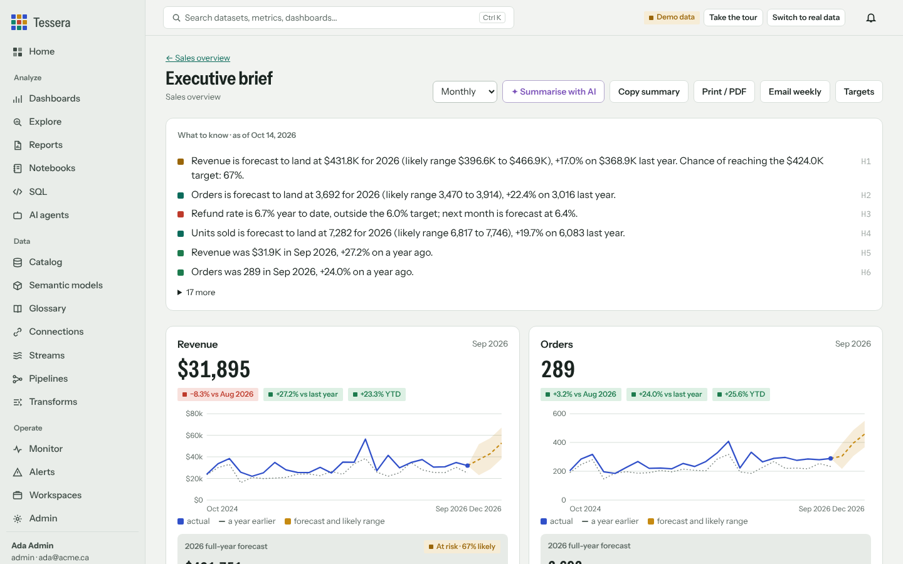
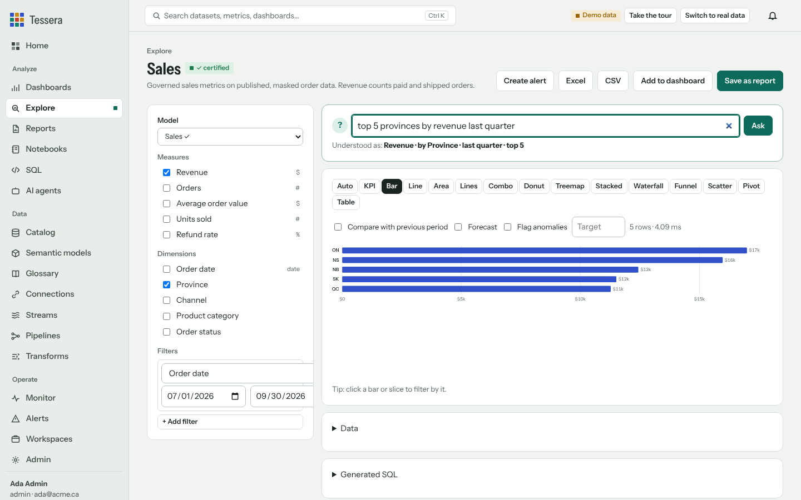
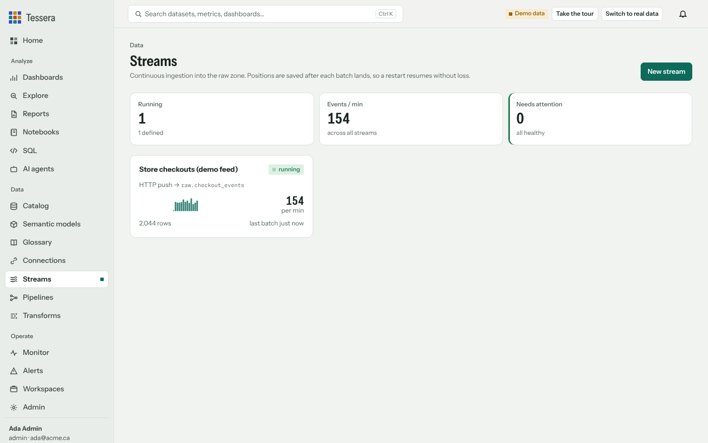
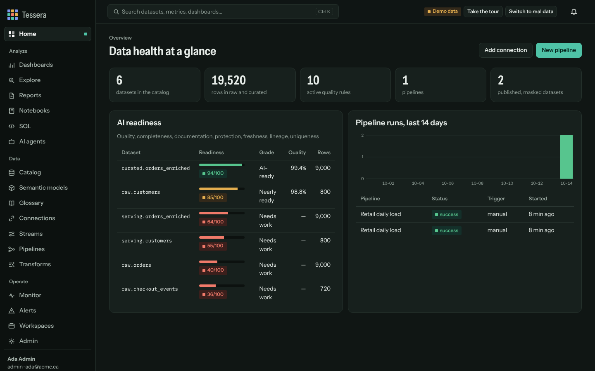

<p align="center">
  
</p>

<h1 align="center">Tessera</h1>

<p align="center">
  <b>The open-source data platform you run yourself.</b><br>
  Connect and stream data, test and protect it, model it once, and give everyone dashboards, executive briefs and AI answers they can trust.
</p>

<p align="center">
  <a href="https://github.com/vvipinthomas/tessera/actions/workflows/ci.yml"></a>
  <a href="LICENSE"></a>
  
  <a href="https://github.com/vvipinthomas/tessera/pkgs/container/tessera"></a>
  <a href="CONTRIBUTING.md"></a>
</p>

<p align="center">
  <a href="#run-it-on-your-computer">Quick start</a> ·
  <a href="docs/USER_GUIDE.md">User guide</a> ·
  <a href="docs/DEPLOY.md">Deploy</a> ·
  <a href="docs/INTEGRATIONS.md">Integrations</a> ·
  <a href="docs/ARCHITECTURE.md">Architecture</a> ·
  <a href="CONTRIBUTING.md">Contributing</a>
</p>


Tessera puts the whole data workflow in one self-hosted application: connectors and streams, pipelines, data quality, personal-data masking, a catalog, semantic models, dashboards, scheduled reports, executive briefs with forecasts, AI agents and an MCP server. It runs on a laptop, a VM or a container. Your data stays on your hardware, and every feature, including SSO, SCIM and audit, is in the free product under Apache 2.0.

## What you can do with it

| | |
|---|---|
| **Bring data in** | 25 connector types: PostgreSQL, SQL Server and Fabric Warehouse, Snowflake, BigQuery, Databricks, Redshift, MySQL, Oracle, Trino, ClickHouse, MongoDB, Elasticsearch, Delta Lake, Apache Iceberg, S3, SFTP, REST APIs, files and any SQLAlchemy database. Full, append and incremental loads. |
| **Stream it** | Kafka (Confluent, Redpanda, MSK), Azure Event Hubs, Amazon Kinesis, MQTT and HTTP push land continuously in tables. Positions are saved after each batch, so a restart never loses events. Dashboards have a Live mode. |
| **Make it trustworthy** | Pipelines with dependencies, retries and schedules. Nine kinds of quality rule, suggested from the data, that can stop bad data before it is published. Personal data is detected and masked on publish. Row-level security follows each person everywhere. |
| **Define it once** | Semantic models hold certified measures such as Revenue and Refund rate, so every report, question and AI answer agrees. A catalog, glossary, lineage and an AI-readiness score per dataset. |
| **Use it** | Ask questions in plain English, explore 15 visuals, build dashboards by dragging tiles, schedule emailed reports and alerts, share or embed read-only links. |
| **Lead with it** | One click from any dashboard: where the year will land, how likely each target is, what moved the numbers, with forecasts that state their method and error. |
| **Ask AI, safely** | Built-in agents (analyst, incident responder, modeler and more) work inside your permissions and every figure they quote is checked against the data. An MCP server gives Claude, IDEs and your own agents the same governed access. |
| **Fit in** | Power BI, Excel and Tableau read governed data through an OData feed. Pipelines deliver published data to Snowflake, BigQuery, Databricks, Fabric or a Delta lake. OpenLineage to Purview, DataHub or Marquez. dbt docs and tests import. Airflow, Dagster and ADF trigger pipelines over the API. |

<table>
<tr>
<td width="50%"></td>
<td width="50%"></td>
</tr>
<tr>
<td></td>
<td></td>
</tr>
</table>

## Run it on your computer

You need Python 3.11 or newer.

```bash
git clone https://github.com/vvipinthomas/tessera.git
cd tessera
python -m venv .venv && source .venv/bin/activate      # Windows: .venv\Scripts\activate
pip install -e ".[s3,kafka,mqtt,iceberg,sftp,delta,mongodb]"
tessera serve
```

Open <http://127.0.0.1:8710>. The terminal prints a one-time **setup code** (it is also saved as `tessera-data/setup-code.txt`). Enter it, create the first admin account, and leave **Start in demo mode** ticked to get a sample retail workspace, a live demo stream and a guided tour of every screen. When you are ready, **Switch to real data** in the top bar removes exactly what the demo created and keeps your users and settings.

Everything Tessera stores lives in one folder, `./tessera-data` by default (set `TESSERA_DATA_DIR` to move it): the metadata database, the DuckDB warehouse, uploads, exports and the encryption key.

<details>
<summary>Install only what you need</summary>

The base install covers files, PostgreSQL, SQLite, REST APIs, HTTP push streams and everything in the app. Add drivers with extras:

| Extra | Adds |
|---|---|
| `kafka` | Kafka, Confluent, Redpanda, MSK and Azure Event Hubs streams |
| `mqtt` | MQTT streams |
| `s3` / `kinesis` | S3 and S3-compatible storage, Kinesis streams |
| `iceberg`, `delta` | Apache Iceberg and Delta Lake tables |
| `sftp` | SFTP file drops |
| `mongodb` | MongoDB, Atlas, Cosmos DB (Mongo API) |
| `mysql`, `sqlserver`, `oracle`, `snowflake`, `bigquery`, `databricks`, `trino`, `clickhouse` | Those databases and warehouses |
| `all` | Every driver that installs without system packages |

SQL Server also needs the Microsoft ODBC Driver 18 on the machine.
</details>

## Run it with Docker

```bash
git clone https://github.com/vvipinthomas/tessera.git && cd tessera
docker compose up -d --build
docker compose logs tessera | grep "Setup code"
```

Open <http://localhost:8710>. Data is kept in the `tessera-data` Docker volume, so upgrades and restarts keep it.

For HTTPS with an automatic certificate, point a domain at the machine and run:

```bash
TESSERA_DOMAIN=tessera.example.com \
  docker compose -f docker-compose.yml -f deploy/https/docker-compose.https.yml up -d --build
```

## Deploy it

Tessera is one process with its data on a local disk (DuckDB plus SQLite). Give it a machine or container **with a persistent volume**, put HTTPS in front, and back up the data folder. Step-by-step guides are in [docs/DEPLOY.md](docs/DEPLOY.md):

| Where | How | Guide |
|---|---|---|
| **AWS** | One CloudFormation stack: EC2 with Docker, an encrypted EBS data volume, HTTPS through Caddy, nightly backups to a private S3 bucket, shell access through Systems Manager. | [AWS](docs/DEPLOY.md#aws) · [`deploy/aws/tessera-ec2.yaml`](deploy/aws/tessera-ec2.yaml) |
| **Cloudflare** | Run Tessera on any server or VM (no open ports) and publish it through a Cloudflare Tunnel, optionally behind Cloudflare Access single sign-on. Host the landing page on Cloudflare Pages. | [Cloudflare](docs/DEPLOY.md#cloudflare) · [`deploy/cloudflare`](deploy/cloudflare) |
| **Any server** | Docker Compose with Caddy for HTTPS. | [Docker](docs/DEPLOY.md#any-server-with-docker) |

> **Why not Cloudflare Workers, Containers, AWS Lambda or Fargate?** They either cannot run a Python server with a native database engine, or they give it a disk that is wiped when the instance sleeps or moves. Tessera would lose its data. The guides explain the options that work.

## Documentation

| Guide | For |
|---|---|
| [User guide](docs/USER_GUIDE.md) | Everyone: every screen, from first sign-in to dashboards, briefs, streams and AI agents |
| [Deploy](docs/DEPLOY.md) | Running Tessera on AWS, Cloudflare or your own server, with HTTPS, backups and upgrades |
| [Configuration](docs/CONFIGURATION.md) | Every environment variable and command-line option |
| [Integrations](docs/INTEGRATIONS.md) | Power BI, Excel, Tableau, streaming sources, dbt, OpenLineage, destinations, orchestrators |
| [MCP server](docs/MCP.md) | Connecting Claude, IDEs and your own agents |
| [Enterprise](docs/ENTERPRISE.md) | SSO, SCIM, workspaces, sharing, metrics, audit, backups |
| [Architecture](docs/ARCHITECTURE.md) | How the pieces fit, the security model and design decisions |
| [Security](SECURITY.md) | Reporting a vulnerability and how releases are checked |

## How it is built

```
sources ─┬─ batch connectors ─┐
         └─ streams ──────────┴─▶ raw ──transform──▶ curated ──quality gate──▶ PII scan ──publish──▶ serving ─┬─▶ dashboards, briefs, AI, MCP
                                  (engineers)          (engineers)                         (masked, RLS)       ├─▶ OData: Power BI, Excel, Tableau
                                                                                                               └─▶ deliver: warehouses, Delta lake
```

Python and FastAPI on the server, DuckDB as the analytical engine (with file and network access switched off for queries), SQLite for metadata, and a dependency-free JavaScript front end. Every query goes through a parser-based guard; people without the engineer role can only read the published, masked zone. Details in [docs/ARCHITECTURE.md](docs/ARCHITECTURE.md).

## Tested, and honest about limits

The release suite has 258 tests plus a browser test that drives 48 screens in light and dark, desktop and mobile. Connectors run against real services or faithful stand-ins: live PostgreSQL, a Kafka-protocol broker with the librdkafka client, a real MQTT broker and SSH/SFTP server, Kinesis and S3 through moto, real Delta and Iceberg tables, and MongoDB and Elasticsearch stand-ins. An authorization matrix calls every route without credentials and as a viewer. `bandit` and `pip-audit` run on every change.

What Tessera is not:

- **One server, not a cluster.** DuckDB spills to disk, so hundreds of gigabytes are practical on one machine; there is no clustering or automatic failover.
- **Micro-batch streaming, not a stream processor.** Events land within a second or two of the batch window. Keep Flink or Spark upstream for windowed joins over unbounded streams.
- **Statistical forecasts.** They learn trend and seasonality from history and show their tested error; they do not know about promotions or price changes.
- **No Python notebooks**, on purpose: running user code would bypass the permission model. Notebooks are SQL and Markdown.
- **No third-party penetration test yet.** The security checks are automated and internal.

Connectors marked *driver* in the app (Snowflake, BigQuery, Databricks, SQL Server, Oracle, Trino, ClickHouse, MySQL, Event Hubs) use each vendor's standard driver and are not exercised by the test suite.

## Contributing

Bug reports, connectors, translations and documentation are all welcome. Start with [CONTRIBUTING.md](CONTRIBUTING.md); it explains the development setup, how to run the tests and what a good pull request looks like. Good first issues are labelled [`good first issue`](https://github.com/vvipinthomas/tessera/labels/good%20first%20issue). Please follow the [code of conduct](CODE_OF_CONDUCT.md).

See [ROADMAP.md](ROADMAP.md) for what is planned and [CHANGELOG.md](CHANGELOG.md) for what changed.

## License

[Apache License 2.0](LICENSE). Bundled fonts (Instrument Sans, IBM Plex Mono) are under the SIL Open Font License; see [NOTICE](NOTICE).

Tessera is built by [Vipin Thomas](https://github.com/vvipinthomas) at Vantoras.
