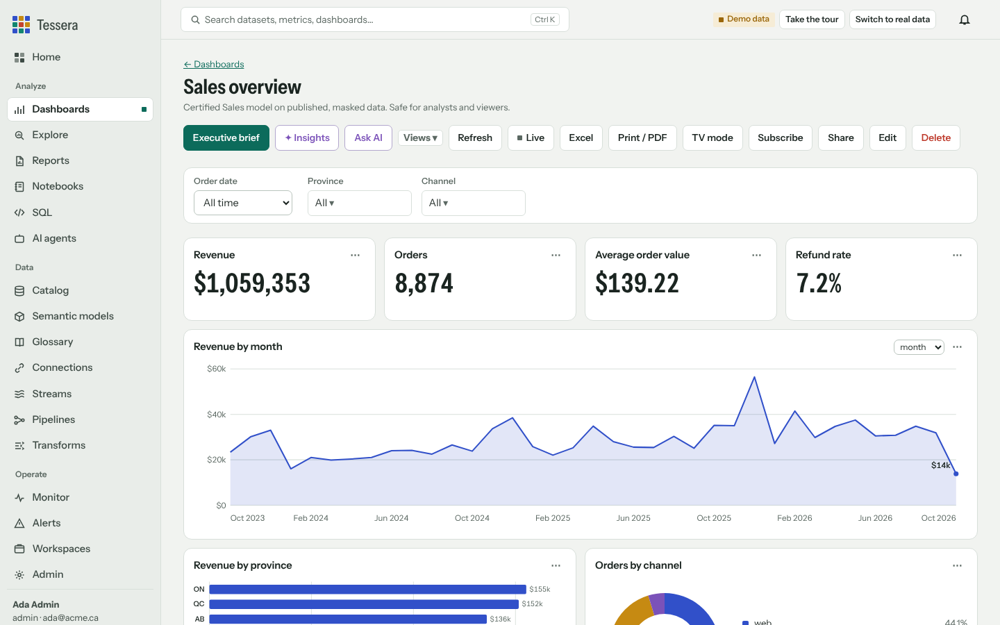

# Tessera

**The open-source data platform you run yourself.** Connect and stream data, test and protect it, model it once, and
give everyone dashboards, executive briefs and AI answers they can trust.



## Start here

| I want to | Read |
|---|---|
| Try Tessera on my computer in two minutes | [Getting started](USER_GUIDE.md#1-getting-started) |
| Learn every screen | [User guide](USER_GUIDE.md) |
| Run it for my team on AWS, Cloudflare or a server | [Deploy](DEPLOY.md) |
| Look up a setting | [Configuration](CONFIGURATION.md) |
| Use it from Power BI, Excel, Tableau, dbt, Airflow or a lineage catalog | [Integrations](INTEGRATIONS.md) |
| Connect Claude, an IDE or my own agents | [MCP server](MCP.md) |
| Set up SSO, SCIM, workspaces and backups | [Enterprise](ENTERPRISE.md) |
| Understand how it works and why | [Architecture](ARCHITECTURE.md) |

## Install

```bash
docker run -d --name tessera -p 8710:8710 -v tessera-data:/data ghcr.io/vvipinthomas/tessera:latest
```

or with Python 3.11+:

```bash
pip install "https://github.com/vvipinthomas/tessera/releases/download/v1.7.4/tessera-1.7.4-py3-none-any.whl"
tessera serve        # http://127.0.0.1:8710
``` The console prints a one-time setup code; enter it in the browser and start in
demo mode for a guided tour.
